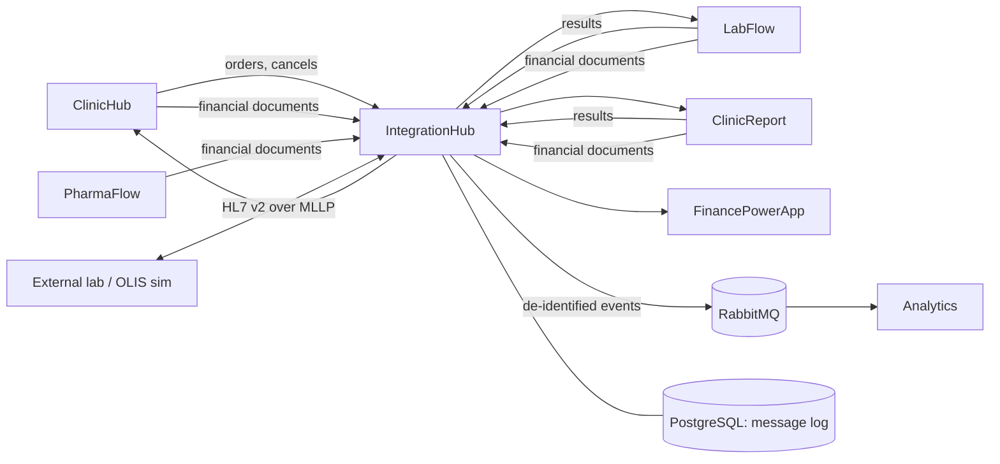

# Architecture and phases

IntegrationHub is the interface engine of the ClinicHub platform: every message between the applications passes
through it, so there is one place to see what was sent, to whom, and what came back, and one place to translate
to the formats the outside world uses (HL7 v2). It is written in **Java 21 / Spring Boot**, because the reference
FHIR and HL7 v2 libraries (HAPI) and most hospital interface engines (Mirth, Rhapsody's tooling) live in Java.

Today the applications call each other directly ([contracts.md](contracts.md)). The hub is put in between **by
configuration only**: each sender's base URL is pointed at a hub route. Pointing it back undoes the change. No
application is rewritten.

## Decisions

1. **A relay first, not a new owner.** ClinicHub owns patients and orders; LabFlow and ClinicReport own results;
   FinancePowerApp owns the books. The hub owns only its message log and its routes.
2. **Synchronous routes stay synchronous.** ClinicHub stores the ids from the transaction-response, and a `409` on a
   cancel is an answer. The hub returns the upstream's status and body unchanged, `502` if the upstream refused the
   connection, `504` on timeout. It does not retry: the senders' outboxes already do.
3. **The sender's token goes through.** The hub validates it (ClinicHub's JWKS, issuer, expiry, an audience and scope
   allowed on that route) and forwards the same `Authorization` header, so each receiver's own checks — "a result only
   from the app the order went to" — keep working. The hub never signs on behalf of another application.
4. **No health information in the log by default.** The log records metadata: route, sender (client id), clinic,
   resource types and counts, Bundle id, identifiers of ServiceRequests/DiagnosticReports, status, latency, size, a
   SHA-256 of the body. Storing bodies is a setting (`hub.payloads.store`), off by default; when on, bodies are
   encrypted (AES-GCM, key from configuration), kept for `hub.payloads.retentionDays` (default 30), and every view of
   a body is written to an access log (PHIPA).
5. **Asynchronous only where the outside world is asynchronous:** HL7 v2 (MLLP, ACKs) and the event feed to Analytics.

## Stack

Java 21, Spring Boot 3, Maven, HAPI FHIR structures R4 (parsing, validation), an own small HL7 v2 parser (phase 4, see its decisions), Spring
Security OAuth2 resource server (JWT), Spring Data JDBC + Flyway, PostgreSQL, RabbitMQ (phase 3), Micrometer +
Prometheus, JUnit 5 + Testcontainers + WireMock, GitHub Actions. API on `:5700`.

## Phases

| Phase | What | Status |
|---|---|---|
| 0 | Skeleton: build, health, CI, Docker, local compose | **Done** |
| 1 | Results relay (LabFlow, ClinicReport → ClinicHub) with token check and message log | **Done** in the hub; the two sender settings below are still to be changed |
| 2 | Orders, cancels and financial documents through the hub | **Done** in the hub; the senders' settings are still to be changed |
| 3 | Event feed to Analytics (de-identified), metrics, message search API | **Done** in the hub; not yet tried with the real applications |
| 4 | HL7 v2: external lab results in (ORU^R01 → FHIR), OLIS-style export out | **Done** in the hub; not tried with a real lab, OLIS or ClinicHub, and no TLS on the listener |
| 5 | New flows: e-prescriptions to PharmaFlow, patient merges, consent flags | **Done** in the hub (contracts, route, log, pseudonym on merges); nothing in the other applications sends or receives them yet |
| 6 | Admin web with ClinicHub sign-in, replay, alerts; platform compose | Not started |

Each phase ends with its tests green in CI, this table updated, and the README's status list updated. Changes needed
in other repositories are listed per phase; they are made there, in their own commits, and noted here.

### Phase 0 — Skeleton

- Maven project `ca.arashkeshtgar.integrationhub`, Java 21, Spring Boot 3 (web, actuator, security, validation,
  data-jdbc, flyway), PostgreSQL driver.
- `GET /actuator/health`, `GET /actuator/info` (version, git commit).
- `compose.yml`: PostgreSQL 16 (port 5433 to avoid clashes), later RabbitMQ.
- Flyway `V1__message_log.sql`: `message` (id uuid, received_at, route, direction, sender_client_id, clinic_slug,
  method, path, content_type, request_size, request_sha256, bundle_id, resource_summary jsonb, upstream_status,
  latency_ms, error), `message_identifier` (message_id, system, value) for searching by ServiceRequest/externalId.
- `Dockerfile` (multi-stage, distroless or temurin-jre), GitHub Actions: `mvn -B verify` with Testcontainers.
- Code style: Spotless (google-java-format). README: how to run.

**Done when:** `mvn verify` passes in CI; `docker compose up` + `mvn spring-boot:run` answers on `:5700/actuator/health`.

**Built:** all of the above. Spring Boot 3.5, Spotless runs in `verify`. Only `/actuator/health` and `/actuator/info`
are open; every other path answers `401` until phase 1 adds the token check. Not built: RabbitMQ in the compose file
(phase 3). Not yet seen running: the first CI run on GitHub, and `docker build` of the full image (see README).

### Phase 1 — Results relay

- Route table in configuration (`hub.routes`): name, upstream base URL, allowed audiences/scopes, timeout. First
  route: `clinichub` → `http://localhost:5300`, accepting the results tokens (scope `results`).
- `POST /route/{route}/fhir` and `/route/{route}/fhir/**`: validate the token (issuer `http://localhost:5301/`, JWKS,
  expiry, scope), parse just enough of the Bundle with HAPI to log its summary (types, `basedOn`, status), forward
  body and headers (`Authorization`, `Content-Type`, `Accept`, `X-Request-Id`; add `X-Forwarded-*`), stream the answer
  back unchanged.
- Invalid token → `401` without forwarding. Unknown route → `404`. Malformed JSON is **forwarded anyway** and logged
  as unparsed: the receiver decides, the hub must not become a stricter validator than the receiver.
- Message log written for every call, including refusals.
- **Tests:** WireMock as ClinicHub; a test JWKS and signed tokens; cases: pass-through of 200/400/409/500 bodies,
  502 on connection refused, 504 on timeout, 401 on bad issuer/expired/wrong scope, log rows written, no body stored.
- **Other repositories:** register client `integrationhub` in ClinicHub `Sso:Clients` (first needed in phase 4; the
  relay does not need its own token). Point the results base URL of LabFlow and ClinicReport (the setting that holds
  ClinicHub's FHIR address in each) at `http://localhost:5700/route/clinichub`. Write in each README how to switch
  back.

**Done when:** a result released in LabFlow and a report signed in ClinicReport reach ClinicHub's results inbox
through the hub, and the log shows both.

**Built (this repository):**

- `hub.routes.*` (`HubProperties`): upstream URL, timeout, connect timeout, allowed audiences, required scopes. Route
  `clinichub` → `http://localhost:5300`, scope `results`. `hub.auth.issuer` / `hub.auth.jwks-uri`.
- `POST /route/{route}/fhir[/**]` (`RelayController`): token check, then body, `Authorization`, `Content-Type`,
  `Accept` and `X-Request-Id` forwarded (an id is added when the sender sent none), `X-Forwarded-For/Proto/Host`
  added. Status, body and headers of the answer come back unchanged, except hop-by-hop headers, and Tomcat writes
  `Content-Type: type;charset=x` without the space. No redirects followed, no retry.
- Refusals are FHIR `OperationOutcome`: `401` (missing or invalid token: signature, issuer, expiry, scope, audience; with
  `WWW-Authenticate: Bearer`), `404` unknown route or `.`/`..` in the path, `413` body over `hub.max-body-bytes`
  (32 MB), `502` upstream unreachable, `504` upstream timeout, `503` when ClinicHub's keys cannot be fetched.
- `BundleSummary` (HAPI R4, parser warnings switched off because they can quote values): resource types and counts,
  Bundle id and type, DiagnosticReport statuses, and the order identifiers from `basedOn` (as `identifier` or as
  `…|id` / `ServiceRequest?identifier=…|id` references) with the clinic slug taken from
  `urn:clinichub:{clinic}:service-request`. A body that does not parse is forwarded and logged `parsed: false`.
- `MessageLog`: one row per call, refusals included, metadata only (no body column). Migration `V2` adds
  `response_status` (what the sender was told); `upstream_status` stays empty when nothing was forwarded. A failing
  log write is reported and does not stop the relay.
- Tests (42 in all): WireMock as ClinicHub and as its JWKS; tokens signed RS256 with `typ: at+jwt`; pass-through of
  200/400/409/422/500/503 and a byte-exact body with non-ASCII text; 502, 504; 401 for no token, garbage, wrong issuer,
  expired, wrong key, wrong or no scope, wrong audience (nothing forwarded each time); log rows and identifiers;
  a check that no marker from the body reaches the database or the application log.
- Found by those tests: ClinicHub's tokens are marked `typ: at+jwt`, which Spring's decoder refuses by default.
  `TokenValidator` accepts `JWT`, `at+jwt` and no type.

**Not built:**

- `hub.payloads.store` (encrypted bodies, access log): the log has no body column at all for now.
- A `503` test for unreachable JWKS (the code path exists).
- Anything other than `POST` and `/fhir`: phase 2 (done).
- Seen with the real LabFlow and ClinicHub (2026-10-18, a developer machine): two released LabFlow results went
  through the `clinichub` route with LabFlow's own token, ClinicHub answered 200 and completed the orders, and the hub
  made their `result.final` events. Not yet seen with ClinicReport.

**Other repositories — to do locally, not done:**

1. **LabFlow: done** — it had no such setting (results went to its OIDC `Authority` + `fhir`, the same setting as
   sign-in), so it got one: `ClinicHub:ResultsUrl=http://localhost:5700/route/clinichub/fhir`; empty switches back.
   The token request still goes straight to ClinicHub. ClinicReport: still to do —
   point the setting that holds ClinicHub's FHIR address at
   `http://localhost:5700/route/clinichub` (they then post to `…/route/clinichub/fhir`). I do not know the setting
   names; look for where `POST {clinichub}/fhir` is built. Write in each README how to switch back (the old value).
   **Check first** that the token request (`/connect/token`, issuer `http://localhost:5301/`) does not use the same
   setting: it must still go straight to ClinicHub, the hub does not relay it.
2. Confirm the open questions in [contracts.md](contracts.md#open-questions-for-the-hub) against a real token (copy the
   payload of one result token, without the signature, into a comment there).
3. ClinicHub: nothing yet. The `integrationhub` client is first needed in phase 4.

### Phase 2 — Orders, cancels, finance

- Routes `labflow` → `:5180`, `clinicreport` → `:5290` (audience = the app, scope `orders`), `finance` → `:5400`
  (audience `finance`, scope `finance`; in development also pass `X-Finance-Key` through).
- Cancels: `PUT /route/{app}/fhir/ServiceRequest?identifier=…` — query string preserved exactly; `409` passed through.
- Finance documents: `POST /route/finance/api/integration/documents`; log each document's `sourceKey`, `externalId`,
  `kind` (no amounts needed in the log).
- **Tests:** contract tests replaying recorded examples of each flow (add sample bodies under
  `src/test/resources/contracts/`, synthetic data only).
- **Other repositories:** ClinicHub `Integrations:LabFlow:FhirBaseUrl`, `Integrations:ClinicReport:FhirBaseUrl`,
  `Integrations:Finance:BaseUrl`; LabFlow/ClinicReport/PharmaFlow finance base URLs → hub routes. Development
  profile `via-hub` in each, so the direct setup stays the default.

**Done when:** an order placed in ClinicHub reaches LabFlow and ClinicReport, a cancel refused with `409` shows the
lab's message in ClinicHub, and a claim reaches FinancePowerApp — all through the hub.

**Built (this repository):**

- Routes `labflow` → `:5180` and `clinicreport` → `:5290` (audience = the app, scope `orders`, `POST` and `PUT` on
  `/fhir`), `finance` → `:5400` (audience and scope `finance`, `POST` on `/api/integration/documents`; `X-Finance-Key`
  is passed through). Each route now says which paths, methods and extra headers it relays and how its body is
  summarised (`allowed-paths`, `allowed-methods`, `forward-headers`, `body-format`). The order of checks is: route and
  path (`404`), method (`405` with `Allow`), token (`401`), then the body.
- Cancel: `PUT /route/{app}/fhir/ServiceRequest?identifier=…`. The query string goes to the app as sent. Tomcat is set
  to accept the characters it normally refuses (`server.tomcat.relaxed-query-chars`), and the relay percent-encodes
  only what a URI cannot carry (a raw `|` becomes `%7C`; `%XX` is never touched), because the JDK client cannot write
  those. The app decodes both to the same value. A `409` comes back with the app's own body and is asked for once.
- Log: an order Bundle's `ServiceRequest` identifiers and statuses (not the Patient or Practitioner: types and counts
  only); a cancel's identifier from the query; for finance each document's `sourceKey`, `externalId` and `kind`
  (also as identifiers `urn:integrationhub:finance:{sourceKey}` → `externalId`, so they can be searched). Amounts,
  parties, references, lines, names, health cards, notes: not read, not stored (tests check the database and the
  application log for markers planted in every sample).
- `X-Finance-Key`: `hub.routes.finance.api-key-header` (env `HUB_ROUTE_FINANCE_API_KEY_HEADER`), empty by default. When
  set, a call with that header and **no** `Authorization` is passed to FinancePowerApp unvalidated (it checks the key);
  a call that has a token is always validated. Meant for development only.
- Contract tests with synthetic samples in `src/test/resources/contracts/` (order Bundle and its transaction-response,
  a cancel and the lab's `409`, finance documents) — 77 tests in all.

**Not built / not known:**

- Whether FinancePowerApp accepts `X-Finance-Key` **instead of** a token or only besides one (contracts.md, question 9).
  Until known the key-only mode is off.
- The order's transaction-response is not read, so the ids ClinicHub stores are not in the log.
- `Expect: 100-continue`, `HEAD`, `OPTIONS`: not relayed.
- Not seen working with the real ClinicHub, LabFlow, ClinicReport, PharmaFlow and FinancePowerApp.

**Other repositories — to do locally, not done:**

1. ClinicHub: `Integrations:LabFlow:FhirBaseUrl`, `Integrations:ClinicReport:FhirBaseUrl` → `http://localhost:5700/route/labflow/fhir`
   and `…/route/clinicreport/fhir` **if the setting holds the full FHIR base (ending in `/fhir`)**, or without `/fhir` if
   ClinicHub appends it; the hub only relays paths that start with `/fhir`. `Integrations:Finance:BaseUrl` →
   `http://localhost:5700/route/finance`. Check how ClinicHub builds the cancel URL from the same setting.
2. LabFlow, ClinicReport, PharmaFlow: their finance base URL → `http://localhost:5700/route/finance`.
3. In each a development profile `via-hub` (or the equivalent), so the direct setup stays the default; write in the
   README how to switch back.
4. Confirm questions 8–12 in [contracts.md](contracts.md#open-questions-for-the-hub) with real tokens and requests.

### Phase 3 — Event feed, metrics, search

- After a relayed call succeeds, publish a **de-identified** event to RabbitMQ exchange `clinical.events` (topic):
  `order.placed`, `order.accepted`, `order.cancelled`, `order.cancel-refused`, `result.final`, `result.amended`,
  `finance.document`. Fields: event id, time, clinic slug, application, test code (LOINC / template key), priority,
  status, ids of the order (`service-request|{id}`), **patient pseudonym** = HMAC-SHA256(secret, clinic + MRN) — never
  names, health cards, birth dates, notes or values. Analytics consumes this (its phase 4). Schema in
  `docs/events.md`, versioned (`schemaVersion`).
- Publishing uses a local outbox table in the same transaction as the log row, so an event is not lost when RabbitMQ
  is down.
- Metrics: messages per route/status, latency histogram, upstream errors. `GET /api/messages?route=&clinic=&status=&identifier=&from=&to=`
  (requires an admin token, phase 6 adds the UI; until then the dev profile allows it locally).

**Built (this repository):**

- **Events** ([events.md](events.md) is the contract, schema version 1): `order.placed`, `order.accepted`,
  `order.cancelled`, `order.cancel-refused`, `result.final`, `result.amended`, `finance.document` to the topic exchange
  `clinical.events` (the hub also declares the durable queue `analytics.clinical-events`, so nothing published before
  Analytics first starts is dropped). Off by default: `HUB_EVENTS_ENABLED=true` and a pseudonym secret of 32+
  characters, or the application does not start. `compose.yml` now has RabbitMQ.
- **Pseudonym** = hex(HMAC-SHA256(secret, `clinic|MRN`)), the MRN read from the Patient identifier with system
  `urn:clinichub:{clinic}:mrn` (setting `hub.events.mrn-system`); never the health card. Results and cancels do not
  carry the patient, so the hub remembers pseudonym, application, test and priority per order (`order_link`, 365 days)
  and uses them for the events of later results and cancels. A result for an unknown order has no pseudonym.
- **Outbox**: events are written to `event_outbox` in the same transaction as the call's log row and sent by a
  publisher with publisher confirms, retrying with a growing pause while RabbitMQ is down. Event ids come from the
  content, so a resent call is one event. Tested with a real broker, including a call relayed while the broker is
  down and published after it starts.
- **Metrics** at `/actuator/prometheus`: `hub.messages{route,status}`, `hub.message.latency{route}` (histogram),
  `hub.upstream.errors{route,kind=timeout|unreachable|http-5xx}`, `hub.events.outbox.pending`,
  `hub.events.outbox.oldest.age.seconds`, `hub.events.published{result}`. The route label is only ever a configured
  route (anything else is `unknown`).
- **Search** `GET /api/messages?route=&clinic=&status=&identifier=&from=&to=&limit=&offset=` (newest first, at most
  200 per page; `identifier` is a value or `system|value`; `status` is what the sender was told) and
  `GET /api/messages/{id}`. Metadata only: there is no body to return.
- **Who may read** the search and the metrics: a ClinicHub token with the permission `integrationhub:messages.view`
  (`hub.admin.permission`), checked like the relay's tokens, and the audience when `hub.admin.audience` is set. The dev
  profile (`--spring.profiles.active=dev`) also lets a call from this machine through without a token, but not one
  that carries `X-Forwarded-For`, `Forwarded` or `X-Real-IP`. Without either, `401`/`403`. Fails closed: the paths
  need an authority only that filter grants.
- **A fix to phase 1**: `MessageLog.write` called its `@Transactional` method on itself, so the transaction never
  applied and a log row and its identifiers were not written atomically. It uses a `TransactionTemplate` now, and a
  test shows that if an event cannot be stored, nothing of the call is.
- Tests: 105 in all (28 new in the events classes, the admin classes and the atomicity test), the events ones against
  a real RabbitMQ in Testcontainers.

**Decisions to check** (where the plan was not exact):

- `order.placed` is made when the application **answered**, not only on success, so that `order.accepted` means
  something different (a refused order is placed and not accepted). The plan says events follow a successful call;
  change `EventFactory.orders` if you want them to coincide.
- Results make events only for `final` and `amended` (the plan's list); `cancelled` and others make none.
- The RabbitMQ health indicator is off: the relay works with the broker down. The state of the feed is the
  `hub.events.outbox.*` metrics.

**Not built / not known:**

- The ClinicHub client `integrationhub` and its permissions do not exist yet (phase 4 / 6), so today a token for the
  log has to be signed by ClinicHub with the permission added by hand; the dev profile is the practical way.
- No consumer (Analytics phase 4) and no dashboards or alert rules for the metrics.
- No free-text search, no total count, no web page (phase 6). `hub.payloads.store` still not built.
- Not tried with the real applications' order Bundles: the MRN system and the identifier on the ServiceRequest are
  assumptions (contracts.md, questions 13–15). If the MRN is not found the event is still made, with no pseudonym.

**Other repositories — to do locally, not done:**

1. ClinicHub: confirm the identifier system of the MRN on the Patient in an order Bundle and the identifier on each
   ServiceRequest; if the MRN's system is not `urn:clinichub:{clinic}:mrn`, set `HUB_EVENTS_MRN_SYSTEM` (or
   `hub.events.mrn-system`).
2. ClinicHub: register the client `integrationhub` and the permission `integrationhub:messages.view` (the other
   phase 6 permissions can wait).
3. Choose and keep the pseudonym secret (`HUB_EVENTS_PSEUDONYM_SECRET`, 32+ characters). **Changing it changes every
   pseudonym**, so the same patient becomes a new one in Analytics.
4. Analytics (its phase 4): declare the queue as in events.md and ignore repeated `eventId`s.

### Phase 4 — HL7 v2

- **In:** MLLP listener (`:2575`) for ORU^R01 from an external lab: validate, map to a FHIR DiagnosticReport +
  Observations (`basedOn` from ORC-2/OBR-2 placer number = ClinicHub's ServiceRequest identifier), send to ClinicHub
  with the hub's own client-credentials token (client `integrationhub`, scope `results`; ClinicHub must accept results
  from this client for orders sent to an external lab — a change in ClinicHub). ACK `AA` when ClinicHub accepted,
  `AE`/`AR` otherwise. This route is asynchronous: store-and-forward with the same backoff as the senders.
- **Out:** LabFlow's open item "HL7 v2 ORU export (OLIS simulation)": copy final lab results relayed in phase 1 to an
  OLIS simulator as ORU^R01 (configurable target; a small simulator under `tools/olis-sim` that logs and ACKs).
- Mapping tables in code, with tests per segment; sample messages synthetic.

**Built (this repository):**

- **MLLP listener** on `:2575` (`hub.hl7.mllp.port`), one virtual thread per connection, many messages per connection,
  each answered before the next is read. Frames over `max-message-bytes` (1 MiB), a bad end of frame or an idle
  connection (`read-timeout`, 30 s) close the connection. Bytes between frames (a stray CR/LF) are skipped.
- **Parser and mapping**, in code and tested per segment (`hl7/`): `Hl7Message` (any HL7 v2.x text: CR, LF or CRLF,
  escapes `\F\ \S\ \T\ \R\ \E\ \Xhh\ \.br\`), `Hl7Tables` (all code tables in one file), `OruToFhir`
  (MSH, ORC/OBR, OBX, NTE; PID is never read), `FhirToOru` (the reverse, for the export), `Hl7Time` (keeps precision).

  | HL7 v2 | FHIR R4 |
  |---|---|
  | MSH-3.MSH-4, MSH-10 | sender id (`EXTLAB.LAB1`) and message id, used for de-duplication; Bundle id and resource ids are derived from them, so a resend gives the same ids |
  | ORC-2 / OBR-2 placer order number `101^harbourview` (or the whole `urn:clinichub:harbourview:service-request` as the first component) | `DiagnosticReport.basedOn.identifier` = `urn:clinichub:harbourview:service-request\|101` |
  | ORC-3 / OBR-3 filler order number | `DiagnosticReport.identifier` (`urn:integrationhub:hl7:{sender}:filler-order`) |
  | OBR-4 | `DiagnosticReport.code` (LN → LOINC, SCT → SNOMED, an unknown system name → `urn:integrationhub:hl7:{sender}:{name}`) |
  | OBR-7 / OBR-22 | `effectiveDateTime` / `issued` |
  | OBR-25 (table 0123) | `status`: F final, C amended, X cancelled; P, R, A, O, I, S, Y are accepted and **not forwarded** (ClinicHub takes final, amended, cancelled) |
  | OBX-2 NM / SN / ST, TX, FT / CE, CWE, CNE | `valueQuantity` (with `<`, `>`, `<=`, `>=` as comparator, unit from OBX-6 as UCUM) / `valueString` / `valueCodeableConcept` |
  | OBX-3 | `Observation.code`; the Observations are `DiagnosticReport.result` |
  | OBX-7 | `referenceRange` (text, and low/high when it is `a-b`, `<a` or `>a`) |
  | OBX-8 (table 0078, repeating) | `interpretation` (v3 ObservationInterpretation); a flag not in the table is kept as text |
  | OBX-11 (table 0085) | `Observation.status`; OBX-14, else OBR-7 → `effectiveDateTime` |
  | NTE after an OBX / after the OBR | `Observation.note` / `DiagnosticReport.conclusion` |
  | PID, PV1, NK1, … | **not read**. No patient is named in what goes to ClinicHub; it knows the patient from the order |

  A message the hub cannot map completely (unknown result status, an OBX value type other than the above, a numeric
  value that is not a number, no placer order number, an OBX before any OBR) is refused with AR; nothing is forwarded
  with a value missing.
- **Store-and-forward** (`hl7_inbound`, migration V4): the message is mapped, written, and handed to ClinicHub at once
  as the client `integrationhub` (client credentials, scope `results`, token cached until 30 s before it expires).
  If ClinicHub (or the network) does not take it (no answer, 408/425/429/5xx, 401) the row stays and the worker
  (`hub.hl7.retry`) tries again after 10 s, 20 s, 40 s … up to 30 min, 12 attempts, then the row is `FAILED`. Any other
  4xx from ClinicHub marks it `REJECTED` and is not retried.
- **ACK**: `AA` = ClinicHub has it, or the message holds nothing to forward (a preliminary result); `AE` = the hub has it
  and is retrying, do not resend; `AR` = refused for good. The ACK text is one of a few fixed phrases and never quotes
  the message. A message the lab sends again (same sender and MSH-10) is recognised: AA if delivered, AE if still
  waiting, and it is processed again only if the first attempt ended `FAILED` or `REJECTED`.
- **Health information at rest**: the queued FHIR Bundle and the queued outbound ORU are encrypted (AES-256-GCM, key
  `HUB_HL7_QUEUE_KEY`, bound to the row id) and the column is set to NULL when the row is delivered, rejected or
  given up. The other columns hold sender, message id, status, counts and a fixed error word. Rows older than
  `retention-days` (14) are purged. Nothing of a message is logged (only fixed reasons); each attempt is a row in
  `message` (route `hl7`, method `MLLP` or `RETRY`, metadata only) and a delivered result makes the same events as a
  relayed one (`result.final`, `result.amended`).
- **Export to OLIS** (`hl7_outbound`): a POST to the `clinichub` route that ClinicHub answered 2xx is also queued, in the
  transaction of its log row, as one ORU^R01 per final / amended / cancelled DiagnosticReport, and sent by a worker to
  `hub.hl7.outbound.host:port` over MLLP; AA marks it sent, anything else is retried like the inbound side, then
  `FAILED`. PID-3 holds only the patient **pseudonym** of the order (`UNKNOWN` when the hub does not know the order);
  no name, birth date or health card number. A report whose values the mapping cannot express (e.g. a boolean) is
  skipped as a whole and counted (`hub.hl7.outbound{result=skipped}`).
- **`tools/olis-sim/OlisSim.java`**: `java tools/olis-sim/OlisSim.java --port 2576 --out received/ --mode accept|error|reject|silent`
  prints one content-free line per message, ACKs, and optionally keeps each message as a file.
- **Settings** (all off by default): `HUB_HL7_ENABLED`, `HUB_HL7_QUEUE_KEY` (32 random bytes, base64), 
  `HUB_CLINICHUB_CLIENT_SECRET`, `HUB_CLINICHUB_TOKEN_URL` (default `{issuer}connect/token`), `HUB_CLINICHUB_FHIR_URL`
  (default `{clinichub route upstream}/fhir`), `HUB_HL7_ALLOWED_SENDERS` (MSH-3.MSH-4, empty = any),
  `HUB_HL7_ZONE` (for times written without a zone), `HUB_HL7_MLLP_PORT`/`BIND`, `HUB_HL7_OUTBOUND_ENABLED`/`HOST`/`PORT`.
  With `hub.hl7.enabled=true` the application does not start without a valid queue key and the ClinicHub settings.
- **Metrics**: `hub.hl7.inbound{result=delivered|retry|failed|rejected|duplicate|accepted-not-forwarded|…}`,
  `hub.hl7.inbound.pending`, `hub.hl7.inbound.failed`, `hub.hl7.outbound{result=queued|sent|retry|failed|skipped}`.
- Tests: 156 in all (51 new: parser and time, a test per mapping area against synthetic messages, framing, ACK,
  cipher, settings, the MLLP server against a real PostgreSQL with ClinicHub played by WireMock — delivery, retry,
  giving up, refusal, duplicates, no health information in logs or the log table — and the export against the real
  `OlisSim` started as a process).

**Decisions to check** (where the plan was not exact):

- **Own HL7 parser instead of HAPI HL7 v2.** The plan listed HAPI HL7 v2. Its parsers are version specific and need a
  structure definition per version (v2.3 ≠ v2.5.1) while labs mix versions; the hub only reads a handful of fields.
  `Hl7Message` is about 270 lines and takes any version. If you want HAPI for validation against a profile, it can be
  added next to it; nothing depends on the choice except the parser class.
- **ACK semantics with store-and-forward**: AA is sent only when ClinicHub has the result, not when the hub has stored
  it; AE (not AA) when it is stored and being retried. A lab that treats AE as "send again" is harmless (duplicates
  are recognised), a lab that treats AE as a failure would raise a false alarm. If the lab wants AA on receipt,
  change `Hl7Inbound.store` — it is one line, but then a result can be acknowledged and still end in `FAILED`.
- **Placer order number format** (`101^harbourview` or the full URN) is an assumption: how an external lab is told the
  order number is not defined anywhere yet (contracts.md, question 16).
- **Preliminary and other non-final statuses are accepted and dropped**, because ClinicHub's results contract is
  final / amended / cancelled (contracts.md flow 3).
- **Character set**: ISO-8859-1 unless MSH-18 says UTF-8.
- **Text values (ST, TX, FT) and NTE comments are read whole**: these types have no components, so a `&` or `^` the
  lab did not escape is kept as text. (Found after the phase: the first version cut the text at it, so
  "Hemolyzed & lipemic" reached ClinicHub as "Hemolyzed ".)
- The export copies results the hub **relayed**, which are LabFlow's and ClinicReport's. It does not export results that
  came in over HL7 (they would go back to where they came from).

**Not built / not known:**

- **No TLS on the MLLP listener or the export.** Run them on a private network or behind a TLS terminator (stunnel,
  the load balancer). Anyone who can reach port 2575 can submit a result for any order; `allowed-senders` only checks
  what the message says about itself. Mutual TLS or an allow-list by address is needed before a real lab connects.
- **Not tried with a real lab, a real OLIS or a real ClinicHub.** Everything was run against synthetic messages, a
  WireMock ClinicHub and `OlisSim`. The real OLIS message profile (required PID and ORC fields, health card number,
  provider and facility identifiers, its own coding of test and specimen) is **not** implemented; the export is an
  ORU^R01 in the shape of the hub's own results, for the simulator.
- Only ORU^R01. No ORM (orders to an external lab), no ADT, no query.
- OBX value types other than NM, SN (simple form), ST, TX, FT, CE, CWE, CNE are refused (no ED/RP attachments, no
  dates, no repeating values). Specimen (SPM) and the OBR parent/child links are ignored.
- A resend of a message whose first copy is still `PENDING` is not compared with it: the first content wins.
- The `integrationhub` client in ClinicHub does not exist yet (see below); until it does the hub cannot deliver and
  every inbound result waits and is finally `FAILED`.
- GitHub Actions has not run on this phase (the tests were run in this session only).
- No admin screen for the queues (phase 6): look at `hl7_inbound` / `hl7_outbound` (no content in them) and the
  metrics; a `FAILED` row means the lab has to resend.

**Other repositories — to do locally, not done:**

1. ClinicHub: register the client `integrationhub` (client credentials) with scope `results` and make the results
   endpoint accept a Bundle from it for an order that went to an **external** lab (today only LabFlow/ClinicReport
   send results). Set `HUB_CLINICHUB_CLIENT_SECRET` to its secret. Confirm that the token endpoint is
   `{issuer}connect/token`, or set `HUB_CLINICHUB_TOKEN_URL`.
2. ClinicHub: decide how an order for an external lab gets its number to the lab, and make it the `101^harbourview`
   form (order id, clinic slug) or the URN form, in ORC-2/OBR-2.
3. ClinicHub: does it take the same Bundle twice (a resend after a lost answer)? The hub sends the same ids each time,
   and an order that is already final may be answered 4xx, which marks the row `REJECTED`.
4. The lab or its interface engine: point it at `hub:2575`, agree the sender id (MSH-3/MSH-4) and what it does with AE.
5. Choose and keep the queue key (`HUB_HL7_QUEUE_KEY`). Losing it makes queued rows unreadable (they are then given
   up after the retries); changing it with rows pending has the same effect.

### Phase 5 — Flows the platform lacks

Each needs work in the other repositories; the hub defines the contract (`docs/contracts.md`) and the route.

1. **E-prescriptions ClinicHub → PharmaFlow:** FHIR MedicationRequest Bundle (patient, prescriber with CPSO, drug as
   DIN, sig, quantity, repeats). PharmaFlow receives it into reception as an electronic prescription.
2. **Patient merges:** when ClinicHub merges two records, send `Patient` with `link.type = replaced-by` to the apps that
   received orders for the merged record.
3. **Consent directives:** mark orders of a patient with a directive (`meta.security` with a confidentiality code), so
   LabFlow and ClinicReport can restrict who sees the result.

**Built (the hub's part):**

- **Contracts** 5 to 7 in [contracts.md](contracts.md) (open questions 20 to 24): the e-prescription Bundle and its
  cancel, the patient-merge Bundle, the confidentiality label. They mirror what ClinicHub already sends for orders (a
  transaction Bundle POSTed to `/fhir`, a cancel as the resource again with a conditional PUT as its `request`).
- **Route `pharmaflow`** (`HUB_ROUTE_PHARMAFLOW_UPSTREAM`, default `http://localhost:5500`): POST only, `aud` `pharmaflow`,
  scope `prescriptions`, relayed unchanged with the sender's token, status and body passed back (a `409` on a cancel is an
  answer). The merge Bundle goes through the existing `labflow` and `clinicreport` routes and this one.
- **Log:** a prescription is its id (`urn:clinichub:{clinic}:prescription|{id}`, searchable and giving the clinic) and
  its status; never the drug, directions, quantity, doctor or patient (a test with markers over the log tables and the
  application log). Confidentiality codes are logged as short codes (anything else as `other`) and counted:
  `hub.consent.labelled{route,code}`.
- **Merges:** a Patient `replaced-by` another, answered `2xx` on a POST, moves the pseudonym the hub remembers with the
  merged patient's orders to the survivor's (`order_link`), so later results carry it. Nothing happens when the app did not
  answer or answered an error (the sender retries), for a merge of someone with no orders here, or for an MRN system the
  hub does not recognise.
- Tests: 12 new (relay unchanged, the refused cancel, the log holding no marker, wrong audience and scope, POST only,
  merges relayed and moving the pseudonym, not moving it when unanswered, labels counted and kept short); 170 in all.

**Not built, said plainly:**

- **Nothing sends or receives these flows yet.** ClinicHub has no prescribing (no drugs, no prescriptions) and sends no
  merge Bundle and no label; PharmaFlow has no electronic-prescription intake and no sign-in through ClinicHub; LabFlow
  and ClinicReport do not read a merge or a label. Tested with synthetic Bundles and WireMock only.
- No event for a prescription or a merge. Events published before a merge keep the old pseudonym; the feed does not say
  two pseudonyms are one person (events.md).
- The hub does not check that a result for a restricted order comes back labelled, and does not add, remove or change
  a label: relaying is unchanged.
- The pseudonym move needs the MRN in the merge Bundle to be in the system the hub reads (`hub.events.mrn-system`).

**Other repositories — to do locally, not done:**

1. **ClinicHub:** (a) a client `pharmaflow` for order-style service tokens: `aud` `pharmaflow`, scope `prescriptions`
   (where it signs the one for LabFlow); (b) send the merge Bundle (flow 6) to each app that received something for the
   merged record, in the transaction of the merge or from its outbox, through the hub route; (c) put `meta.security` on
   an order or prescription a consent directive covers, and decide which directive is which code (question 23);
   (d) **prescribing**, which does not exist: drugs (DIN), directions, quantity, repeats, a prescription that is signed,
   its Bundle, its cancel. That is a module of its own, not a change.
2. **PharmaFlow:** (a) an intake for the e-prescription Bundle into reception (its README lists it as open), idempotent
   on the prescription identifier; (b) sign-in through ClinicHub and a check of the service token (`aud`, scope); (c) a
   cancel that answers `409` once dispensing has started; (d) read the merge Bundle.
3. **LabFlow, ClinicReport:** read the merge Bundle (repoint what they hold for the merged MRN, question 22) and the
   label (limit who sees the order and its result, and put the label on the report they send back).
4. **Analytics:** nothing, unless it should unify a merged patient's two pseudonyms: that needs a `patient.merged` event
   the hub does not send.

### Phase 6 — Admin web and operations

- Admin web (`web/`, React + Vite, `:5701`) signed in through ClinicHub (client `integrationhub`, permissions
  `integrationhub:messages.view`, `integrationhub:payloads.view`, `integrationhub:messages.replay`).
- Message search, a message's timeline, replay of an asynchronous message, dead letters, route health.
- Alerts: upstream failing for N minutes → log + optional e-mail/webhook.
- Join the platform compose (ControlPanel), Docker image published from CI.

## Not in scope

- Rewriting any of the .NET applications, or moving their outboxes into the hub.
- A FHIR server (storage, search). The hub relays; it is not a clinical data repository.
- Real OLIS, real OHIP, real PharmaNet/ePrescribe connections: simulated only, synthetic data only.
