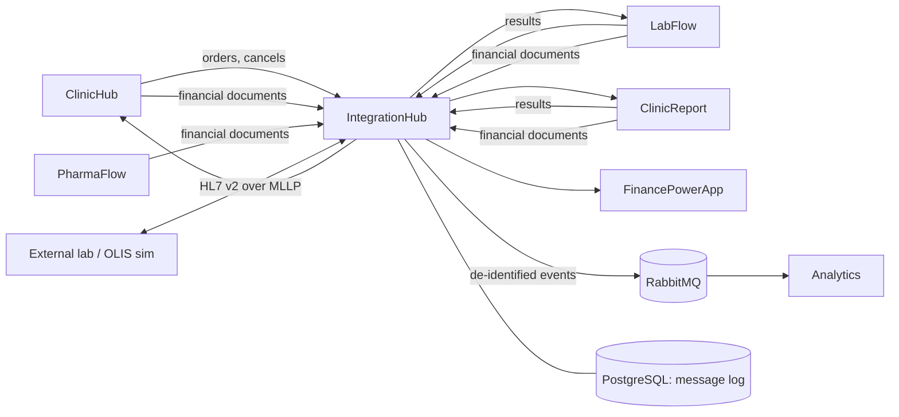

# Architecture and phases

IntegrationHub is the interface engine of the ClinicHub platform: every message between the applications passes
through it, so there is one place to see what was sent, to whom, and what came back, and one place to translate
to the formats the outside world uses (HL7 v2). It is written in **Java 21 / Spring Boot**, because the reference
FHIR and HL7 v2 libraries (HAPI) and most hospital interface engines (Mirth, Rhapsody's tooling) live in Java.

Today the applications call each other directly ([contracts.md](contracts.md)). The hub is put in between **by
configuration only**: each sender's base URL is pointed at a hub route. Pointing it back undoes the change. No
application is rewritten.

## Decisions

1. **A relay first, not a new owner.** ClinicHub owns patients and orders; LabFlow and ClinicReport own results;
   FinancePowerApp owns the books. The hub owns only its message log and its routes.
2. **Synchronous routes stay synchronous.** ClinicHub stores the ids from the transaction-response, and a `409` on a
   cancel is an answer. The hub returns the upstream's status and body unchanged, `502` if the upstream refused the
   connection, `504` on timeout. It does not retry: the senders' outboxes already do.
3. **The sender's token goes through.** The hub validates it (ClinicHub's JWKS, issuer, expiry, an audience and scope
   allowed on that route) and forwards the same `Authorization` header, so each receiver's own checks — "a result only
   from the app the order went to" — keep working. The hub never signs on behalf of another application.
4. **No health information in the log by default.** The log records metadata: route, sender (client id), clinic,
   resource types and counts, Bundle id, identifiers of ServiceRequests/DiagnosticReports, status, latency, size, a
   SHA-256 of the body. Storing bodies is a setting (`hub.payloads.store`), off by default; when on, bodies are
   encrypted (AES-GCM, key from configuration), kept for `hub.payloads.retentionDays` (default 30), and every view of
   a body is written to an access log (PHIPA).
5. **Asynchronous only where the outside world is asynchronous:** HL7 v2 (MLLP, ACKs) and the event feed to Analytics.

## Stack

Java 21, Spring Boot 3, Maven, HAPI FHIR structures R4 (parsing, validation), HAPI HL7 v2 (phase 4), Spring
Security OAuth2 resource server (JWT), Spring Data JDBC + Flyway, PostgreSQL, RabbitMQ (phase 3), Micrometer +
Prometheus, JUnit 5 + Testcontainers + WireMock, GitHub Actions. API on `:5700`.

## Phases

| Phase | What | Status |
|---|---|---|
| 0 | Skeleton: build, health, CI, Docker, local compose | **Done** |
| 1 | Results relay (LabFlow, ClinicReport → ClinicHub) with token check and message log | **Done** in the hub; the two sender settings below are still to be changed |
| 2 | Orders, cancels and financial documents through the hub | **Done** in the hub; the senders' settings are still to be changed |
| 3 | Event feed to Analytics (de-identified), metrics, message search API | **Done** in the hub; not yet tried with the real applications |
| 4 | HL7 v2: external lab results in (ORU^R01 → FHIR), OLIS-style export out | Not started |
| 5 | New flows: e-prescriptions to PharmaFlow, patient merges, consent flags | Not started |
| 6 | Admin web with ClinicHub sign-in, replay, alerts; platform compose | Not started |

Each phase ends with its tests green in CI, this table updated, and the README's status list updated. Changes needed
in other repositories are listed per phase; they are made there, in their own commits, and noted here.

### Phase 0 — Skeleton

- Maven project `ca.arashkeshtgar.integrationhub`, Java 21, Spring Boot 3 (web, actuator, security, validation,
  data-jdbc, flyway), PostgreSQL driver.
- `GET /actuator/health`, `GET /actuator/info` (version, git commit).
- `compose.yml`: PostgreSQL 16 (port 5433 to avoid clashes), later RabbitMQ.
- Flyway `V1__message_log.sql`: `message` (id uuid, received_at, route, direction, sender_client_id, clinic_slug,
  method, path, content_type, request_size, request_sha256, bundle_id, resource_summary jsonb, upstream_status,
  latency_ms, error), `message_identifier` (message_id, system, value) for searching by ServiceRequest/externalId.
- `Dockerfile` (multi-stage, distroless or temurin-jre), GitHub Actions: `mvn -B verify` with Testcontainers.
- Code style: Spotless (google-java-format). README: how to run.

**Done when:** `mvn verify` passes in CI; `docker compose up` + `mvn spring-boot:run` answers on `:5700/actuator/health`.

**Built:** all of the above. Spring Boot 3.5, Spotless runs in `verify`. Only `/actuator/health` and `/actuator/info`
are open; every other path answers `401` until phase 1 adds the token check. Not built: RabbitMQ in the compose file
(phase 3). Not yet seen running: the first CI run on GitHub, and `docker build` of the full image (see README).

### Phase 1 — Results relay

- Route table in configuration (`hub.routes`): name, upstream base URL, allowed audiences/scopes, timeout. First
  route: `clinichub` → `http://localhost:5300`, accepting the results tokens (scope `results`).
- `POST /route/{route}/fhir` and `/route/{route}/fhir/**`: validate the token (issuer `http://localhost:5301/`, JWKS,
  expiry, scope), parse just enough of the Bundle with HAPI to log its summary (types, `basedOn`, status), forward
  body and headers (`Authorization`, `Content-Type`, `Accept`, `X-Request-Id`; add `X-Forwarded-*`), stream the answer
  back unchanged.
- Invalid token → `401` without forwarding. Unknown route → `404`. Malformed JSON is **forwarded anyway** and logged
  as unparsed: the receiver decides, the hub must not become a stricter validator than the receiver.
- Message log written for every call, including refusals.
- **Tests:** WireMock as ClinicHub; a test JWKS and signed tokens; cases: pass-through of 200/400/409/500 bodies,
  502 on connection refused, 504 on timeout, 401 on bad issuer/expired/wrong scope, log rows written, no body stored.
- **Other repositories:** register client `integrationhub` in ClinicHub `Sso:Clients` (first needed in phase 4; the
  relay does not need its own token). Point the results base URL of LabFlow and ClinicReport (the setting that holds
  ClinicHub's FHIR address in each) at `http://localhost:5700/route/clinichub`. Write in each README how to switch
  back.

**Done when:** a result released in LabFlow and a report signed in ClinicReport reach ClinicHub's results inbox
through the hub, and the log shows both.

**Built (this repository):**

- `hub.routes.*` (`HubProperties`): upstream URL, timeout, connect timeout, allowed audiences, required scopes. Route
  `clinichub` → `http://localhost:5300`, scope `results`. `hub.auth.issuer` / `hub.auth.jwks-uri`.
- `POST /route/{route}/fhir[/**]` (`RelayController`): token check, then body, `Authorization`, `Content-Type`,
  `Accept` and `X-Request-Id` forwarded (an id is added when the sender sent none), `X-Forwarded-For/Proto/Host`
  added. Status, body and headers of the answer come back unchanged, except hop-by-hop headers, and Tomcat writes
  `Content-Type: type;charset=x` without the space. No redirects followed, no retry.
- Refusals are FHIR `OperationOutcome`: `401` (missing or invalid token: signature, issuer, expiry, scope, audience; with
  `WWW-Authenticate: Bearer`), `404` unknown route or `.`/`..` in the path, `413` body over `hub.max-body-bytes`
  (32 MB), `502` upstream unreachable, `504` upstream timeout, `503` when ClinicHub's keys cannot be fetched.
- `BundleSummary` (HAPI R4, parser warnings switched off because they can quote values): resource types and counts,
  Bundle id and type, DiagnosticReport statuses, and the order identifiers from `basedOn` (as `identifier` or as
  `…|id` / `ServiceRequest?identifier=…|id` references) with the clinic slug taken from
  `urn:clinichub:{clinic}:service-request`. A body that does not parse is forwarded and logged `parsed: false`.
- `MessageLog`: one row per call, refusals included, metadata only (no body column). Migration `V2` adds
  `response_status` (what the sender was told); `upstream_status` stays empty when nothing was forwarded. A failing
  log write is reported and does not stop the relay.
- Tests (42 in all): WireMock as ClinicHub and as its JWKS; tokens signed RS256 with `typ: at+jwt`; pass-through of
  200/400/409/422/500/503 and a byte-exact body with non-ASCII text; 502, 504; 401 for no token, garbage, wrong issuer,
  expired, wrong key, wrong or no scope, wrong audience (nothing forwarded each time); log rows and identifiers;
  a check that no marker from the body reaches the database or the application log.
- Found by those tests: ClinicHub's tokens are marked `typ: at+jwt`, which Spring's decoder refuses by default.
  `TokenValidator` accepts `JWT`, `at+jwt` and no type.

**Not built:**

- `hub.payloads.store` (encrypted bodies, access log): the log has no body column at all for now.
- A `503` test for unreachable JWKS (the code path exists).
- Anything other than `POST` and `/fhir`: phase 2 (done).
- Not seen working with the real LabFlow, ClinicReport and ClinicHub (they are not available to this session).

**Other repositories — to do locally, not done:**

1. LabFlow and ClinicReport: point the setting that holds ClinicHub's FHIR address at
   `http://localhost:5700/route/clinichub` (they then post to `…/route/clinichub/fhir`). I do not know the setting
   names; look for where `POST {clinichub}/fhir` is built. Write in each README how to switch back (the old value).
   **Check first** that the token request (`/connect/token`, issuer `http://localhost:5301/`) does not use the same
   setting: it must still go straight to ClinicHub, the hub does not relay it.
2. Confirm the open questions in [contracts.md](contracts.md#open-questions-for-the-hub) against a real token (copy the
   payload of one result token, without the signature, into a comment there).
3. ClinicHub: nothing yet. The `integrationhub` client is first needed in phase 4.

### Phase 2 — Orders, cancels, finance

- Routes `labflow` → `:5180`, `clinicreport` → `:5290` (audience = the app, scope `orders`), `finance` → `:5400`
  (audience `finance`, scope `finance`; in development also pass `X-Finance-Key` through).
- Cancels: `PUT /route/{app}/fhir/ServiceRequest?identifier=…` — query string preserved exactly; `409` passed through.
- Finance documents: `POST /route/finance/api/integration/documents`; log each document's `sourceKey`, `externalId`,
  `kind` (no amounts needed in the log).
- **Tests:** contract tests replaying recorded examples of each flow (add sample bodies under
  `src/test/resources/contracts/`, synthetic data only).
- **Other repositories:** ClinicHub `Integrations:LabFlow:FhirBaseUrl`, `Integrations:ClinicReport:FhirBaseUrl`,
  `Integrations:Finance:BaseUrl`; LabFlow/ClinicReport/PharmaFlow finance base URLs → hub routes. Development
  profile `via-hub` in each, so the direct setup stays the default.

**Done when:** an order placed in ClinicHub reaches LabFlow and ClinicReport, a cancel refused with `409` shows the
lab's message in ClinicHub, and a claim reaches FinancePowerApp — all through the hub.

**Built (this repository):**

- Routes `labflow` → `:5180` and `clinicreport` → `:5290` (audience = the app, scope `orders`, `POST` and `PUT` on
  `/fhir`), `finance` → `:5400` (audience and scope `finance`, `POST` on `/api/integration/documents`; `X-Finance-Key`
  is passed through). Each route now says which paths, methods and extra headers it relays and how its body is
  summarised (`allowed-paths`, `allowed-methods`, `forward-headers`, `body-format`). The order of checks is: route and
  path (`404`), method (`405` with `Allow`), token (`401`), then the body.
- Cancel: `PUT /route/{app}/fhir/ServiceRequest?identifier=…`. The query string goes to the app as sent. Tomcat is set
  to accept the characters it normally refuses (`server.tomcat.relaxed-query-chars`), and the relay percent-encodes
  only what a URI cannot carry (a raw `|` becomes `%7C`; `%XX` is never touched), because the JDK client cannot write
  those. The app decodes both to the same value. A `409` comes back with the app's own body and is asked for once.
- Log: an order Bundle's `ServiceRequest` identifiers and statuses (not the Patient or Practitioner: types and counts
  only); a cancel's identifier from the query; for finance each document's `sourceKey`, `externalId` and `kind`
  (also as identifiers `urn:integrationhub:finance:{sourceKey}` → `externalId`, so they can be searched). Amounts,
  parties, references, lines, names, health cards, notes: not read, not stored (tests check the database and the
  application log for markers planted in every sample).
- `X-Finance-Key`: `hub.routes.finance.api-key-header` (env `HUB_ROUTE_FINANCE_API_KEY_HEADER`), empty by default. When
  set, a call with that header and **no** `Authorization` is passed to FinancePowerApp unvalidated (it checks the key);
  a call that has a token is always validated. Meant for development only.
- Contract tests with synthetic samples in `src/test/resources/contracts/` (order Bundle and its transaction-response,
  a cancel and the lab's `409`, finance documents) — 77 tests in all.

**Not built / not known:**

- Whether FinancePowerApp accepts `X-Finance-Key` **instead of** a token or only besides one (contracts.md, question 9).
  Until known the key-only mode is off.
- The order's transaction-response is not read, so the ids ClinicHub stores are not in the log.
- `Expect: 100-continue`, `HEAD`, `OPTIONS`: not relayed.
- Not seen working with the real ClinicHub, LabFlow, ClinicReport, PharmaFlow and FinancePowerApp.

**Other repositories — to do locally, not done:**

1. ClinicHub: `Integrations:LabFlow:FhirBaseUrl`, `Integrations:ClinicReport:FhirBaseUrl` → `http://localhost:5700/route/labflow/fhir`
   and `…/route/clinicreport/fhir` **if the setting holds the full FHIR base (ending in `/fhir`)**, or without `/fhir` if
   ClinicHub appends it; the hub only relays paths that start with `/fhir`. `Integrations:Finance:BaseUrl` →
   `http://localhost:5700/route/finance`. Check how ClinicHub builds the cancel URL from the same setting.
2. LabFlow, ClinicReport, PharmaFlow: their finance base URL → `http://localhost:5700/route/finance`.
3. In each a development profile `via-hub` (or the equivalent), so the direct setup stays the default; write in the
   README how to switch back.
4. Confirm questions 8–12 in [contracts.md](contracts.md#open-questions-for-the-hub) with real tokens and requests.

### Phase 3 — Event feed, metrics, search

- After a relayed call succeeds, publish a **de-identified** event to RabbitMQ exchange `clinical.events` (topic):
  `order.placed`, `order.accepted`, `order.cancelled`, `order.cancel-refused`, `result.final`, `result.amended`,
  `finance.document`. Fields: event id, time, clinic slug, application, test code (LOINC / template key), priority,
  status, ids of the order (`service-request|{id}`), **patient pseudonym** = HMAC-SHA256(secret, clinic + MRN) — never
  names, health cards, birth dates, notes or values. Analytics consumes this (its phase 4). Schema in
  `docs/events.md`, versioned (`schemaVersion`).
- Publishing uses a local outbox table in the same transaction as the log row, so an event is not lost when RabbitMQ
  is down.
- Metrics: messages per route/status, latency histogram, upstream errors. `GET /api/messages?route=&clinic=&status=&identifier=&from=&to=`
  (requires an admin token, phase 6 adds the UI; until then the dev profile allows it locally).

**Built (this repository):**

- **Events** ([events.md](events.md) is the contract, schema version 1): `order.placed`, `order.accepted`,
  `order.cancelled`, `order.cancel-refused`, `result.final`, `result.amended`, `finance.document` to the topic exchange
  `clinical.events` (the hub also declares the durable queue `analytics.clinical-events`, so nothing published before
  Analytics first starts is dropped). Off by default: `HUB_EVENTS_ENABLED=true` and a pseudonym secret of 32+
  characters, or the application does not start. `compose.yml` now has RabbitMQ.
- **Pseudonym** = hex(HMAC-SHA256(secret, `clinic|MRN`)), the MRN read from the Patient identifier with system
  `urn:clinichub:{clinic}:mrn` (setting `hub.events.mrn-system`); never the health card. Results and cancels do not
  carry the patient, so the hub remembers pseudonym, application, test and priority per order (`order_link`, 365 days)
  and uses them for the events of later results and cancels. A result for an unknown order has no pseudonym.
- **Outbox**: events are written to `event_outbox` in the same transaction as the call's log row and sent by a
  publisher with publisher confirms, retrying with a growing pause while RabbitMQ is down. Event ids come from the
  content, so a resent call is one event. Tested with a real broker, including a call relayed while the broker is
  down and published after it starts.
- **Metrics** at `/actuator/prometheus`: `hub.messages{route,status}`, `hub.message.latency{route}` (histogram),
  `hub.upstream.errors{route,kind=timeout|unreachable|http-5xx}`, `hub.events.outbox.pending`,
  `hub.events.outbox.oldest.age.seconds`, `hub.events.published{result}`. The route label is only ever a configured
  route (anything else is `unknown`).
- **Search** `GET /api/messages?route=&clinic=&status=&identifier=&from=&to=&limit=&offset=` (newest first, at most
  200 per page; `identifier` is a value or `system|value`; `status` is what the sender was told) and
  `GET /api/messages/{id}`. Metadata only: there is no body to return.
- **Who may read** the search and the metrics: a ClinicHub token with the permission `integrationhub:messages.view`
  (`hub.admin.permission`), checked like the relay's tokens, and the audience when `hub.admin.audience` is set. The dev
  profile (`--spring.profiles.active=dev`) also lets a call from this machine through without a token, but not one
  that carries `X-Forwarded-For`, `Forwarded` or `X-Real-IP`. Without either, `401`/`403`. Fails closed: the paths
  need an authority only that filter grants.
- **A fix to phase 1**: `MessageLog.write` called its `@Transactional` method on itself, so the transaction never
  applied and a log row and its identifiers were not written atomically. It uses a `TransactionTemplate` now, and a
  test shows that if an event cannot be stored, nothing of the call is.
- Tests: 105 in all (28 new in the events classes, the admin classes and the atomicity test), the events ones against
  a real RabbitMQ in Testcontainers.

**Decisions to check** (where the plan was not exact):

- `order.placed` is made when the application **answered**, not only on success, so that `order.accepted` means
  something different (a refused order is placed and not accepted). The plan says events follow a successful call;
  change `EventFactory.orders` if you want them to coincide.
- Results make events only for `final` and `amended` (the plan's list); `cancelled` and others make none.
- The RabbitMQ health indicator is off: the relay works with the broker down. The state of the feed is the
  `hub.events.outbox.*` metrics.

**Not built / not known:**

- The ClinicHub client `integrationhub` and its permissions do not exist yet (phase 4 / 6), so today a token for the
  log has to be signed by ClinicHub with the permission added by hand; the dev profile is the practical way.
- No consumer (Analytics phase 4) and no dashboards or alert rules for the metrics.
- No free-text search, no total count, no web page (phase 6). `hub.payloads.store` still not built.
- Not tried with the real applications' order Bundles: the MRN system and the identifier on the ServiceRequest are
  assumptions (contracts.md, questions 13–15). If the MRN is not found the event is still made, with no pseudonym.

**Other repositories — to do locally, not done:**

1. ClinicHub: confirm the identifier system of the MRN on the Patient in an order Bundle and the identifier on each
   ServiceRequest; if the MRN's system is not `urn:clinichub:{clinic}:mrn`, set `HUB_EVENTS_MRN_SYSTEM` (or
   `hub.events.mrn-system`).
2. ClinicHub: register the client `integrationhub` and the permission `integrationhub:messages.view` (the other
   phase 6 permissions can wait).
3. Choose and keep the pseudonym secret (`HUB_EVENTS_PSEUDONYM_SECRET`, 32+ characters). **Changing it changes every
   pseudonym**, so the same patient becomes a new one in Analytics.
4. Analytics (its phase 4): declare the queue as in events.md and ignore repeated `eventId`s.

### Phase 4 — HL7 v2

- **In:** MLLP listener (`:2575`) for ORU^R01 from an external lab: validate, map to a FHIR DiagnosticReport +
  Observations (`basedOn` from ORC-2/OBR-2 placer number = ClinicHub's ServiceRequest identifier), send to ClinicHub
  with the hub's own client-credentials token (client `integrationhub`, scope `results`; ClinicHub must accept results
  from this client for orders sent to an external lab — a change in ClinicHub). ACK `AA` when ClinicHub accepted,
  `AE`/`AR` otherwise. This route is asynchronous: store-and-forward with the same backoff as the senders.
- **Out:** LabFlow's open item "HL7 v2 ORU export (OLIS simulation)": copy final lab results relayed in phase 1 to an
  OLIS simulator as ORU^R01 (configurable target; a small simulator under `tools/olis-sim` that logs and ACKs).
- Mapping tables in code, with tests per segment; sample messages synthetic.

### Phase 5 — Flows the platform lacks

Each needs work in the other repositories; the hub defines the contract (`docs/contracts.md`) and the route.

1. **E-prescriptions ClinicHub → PharmaFlow:** FHIR MedicationRequest Bundle (patient, prescriber with CPSO, drug as
   DIN, sig, quantity, repeats). PharmaFlow receives it into reception as an electronic prescription.
2. **Patient merges:** when ClinicHub merges two records, send `Patient` with `link.type = replaced-by` to the apps that
   received orders for the merged record.
3. **Consent directives:** mark orders of a patient with a directive (`meta.security` with a confidentiality code), so
   LabFlow and ClinicReport can restrict who sees the result.

### Phase 6 — Admin web and operations

- Admin web (`web/`, React + Vite, `:5701`) signed in through ClinicHub (client `integrationhub`, permissions
  `integrationhub:messages.view`, `integrationhub:payloads.view`, `integrationhub:messages.replay`).
- Message search, a message's timeline, replay of an asynchronous message, dead letters, route health.
- Alerts: upstream failing for N minutes → log + optional e-mail/webhook.
- Join the platform compose (ControlPanel), Docker image published from CI.

## Not in scope

- Rewriting any of the .NET applications, or moving their outboxes into the hub.
- A FHIR server (storage, search). The hub relays; it is not a clinical data repository.
- Real OLIS, real OHIP, real PharmaNet/ePrescribe connections: simulated only, synthetic data only.
